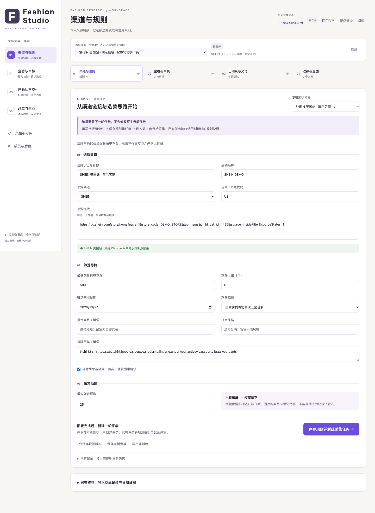

# Fashion Selection Workbench｜女装选款工作台

把来源采集、筛选规则、证据核验、人工审核、改款与图文交付放在一个可追踪流程中。

## 功能
- 规则快照、日历月款龄计算、销量标签解析；SKU 月份只作为估计线索。
- 持久化队列、分页检查、断点恢复；访问验证或限制出现时暂停。
- 原始图库、正背面与颜色图分开；资料变化后使旧审核失效。
- 人工确认、改款方案版本、生成任务防重与未知结果核对。
- Excel 内嵌图片和 ZIP 交付，校验图片数量与记录版本。
- 账号与访问边界、可选 Chrome 采集助手。

## 启动
Python 3.10+；macOS/Linux。

    python3 -m venv .venv
    . .venv/bin/activate
    pip install -r requirements.txt
    python server.py

打开 http://127.0.0.1:8770 并初始化管理员。默认来源链接是 DEMO_STORE 占位，需在界面替换为自己获授权的实际来源。空白风格规则在 examples/style-rules.json，不会沿用私人风格资料库。

Chrome 助手在 chrome-helper/，通过开发者模式加载已解压扩展。只在自己已登录并获准访问的来源使用；人机验证由使用者处理。没有自动上架、交易、改价和绕过验证功能。

Excel 使用普通 openpyxl，无需 Codex 专用表格包；公开版不生成旧工具的工作表预览 PNG。生图为可选 ComfyUI 适配，需自行配置并逐次确认。

## 检查

    python -m unittest discover -p 'test_*.py'
    npm install
    npm test

页面测试需要已安装 Chrome，或通过 TEST_CHROME 指向自己的浏览器可执行文件。

Node.js 仅用于 JavaScript 检查和扩展相关开发。测试中的账号、图片和商品为临时合成夹具。

参见 [验证记录](VALIDATION.md)、[发布范围](PUBLICATION.md)。
